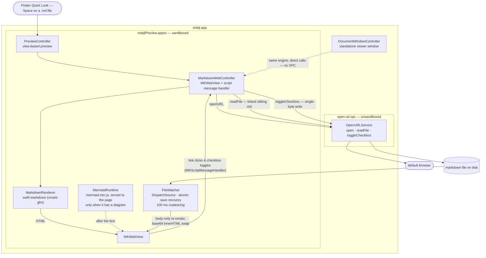
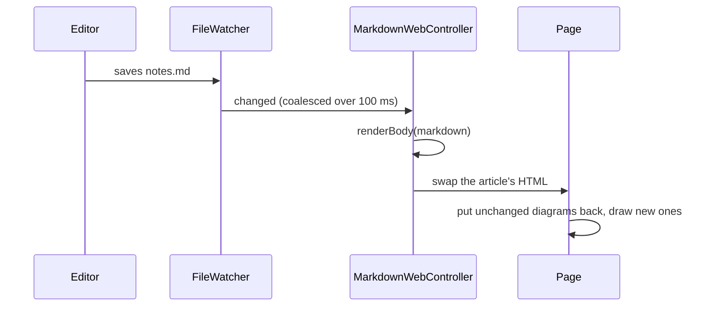
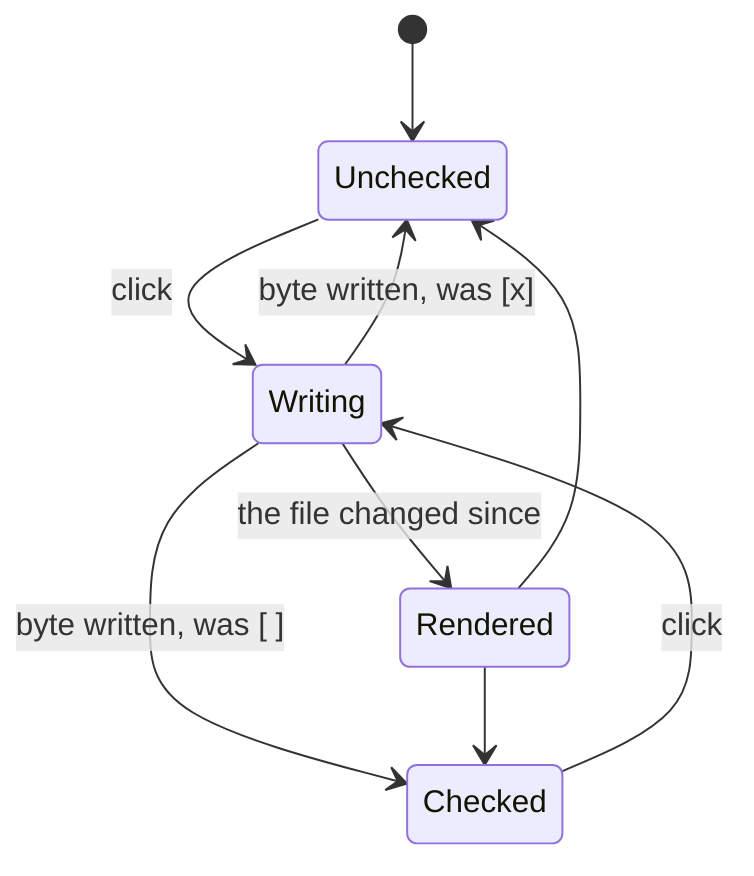
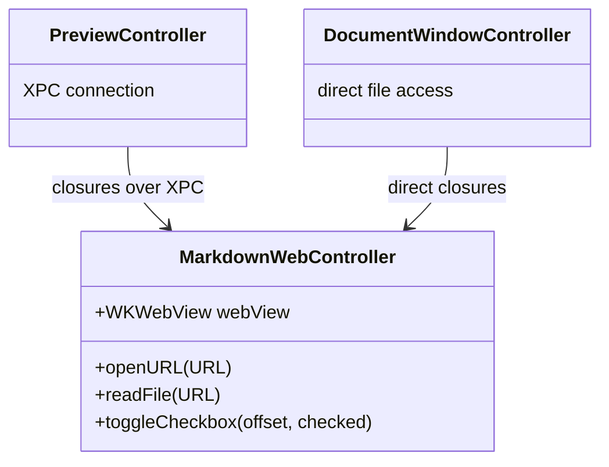
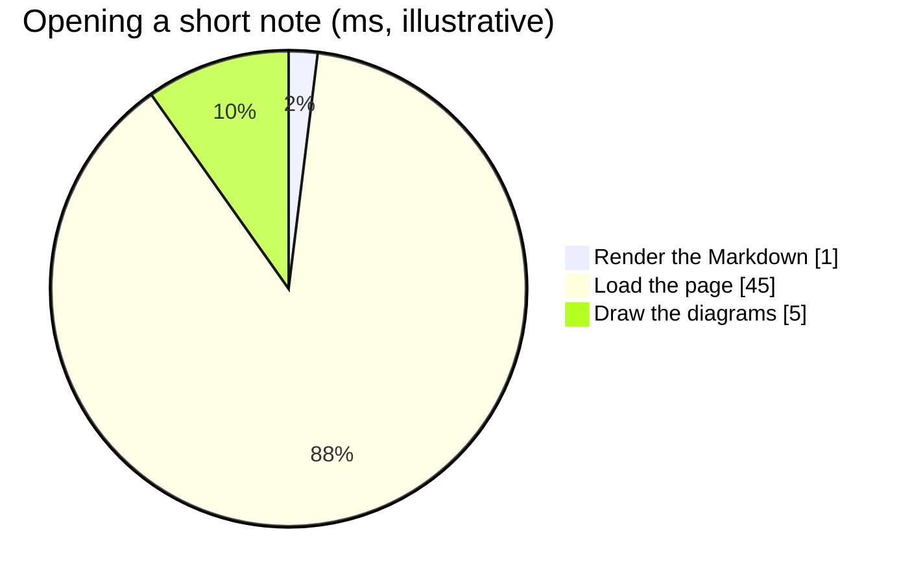

# Mermaid in mdql

A ` ```mermaid ` fence renders as a diagram, in Quick Look and in the viewer alike. The text shows first; the diagrams follow a moment later, drawn in light or dark to match the system. Nothing is fetched: the Mermaid runtime ships inside mdql.

## Flowchart: how a preview is put together



## Sequence diagram: a live update



## State diagram: a task-list checkbox



## Class diagram: what each host gives the engine



## Pie chart: where an open spends its time


